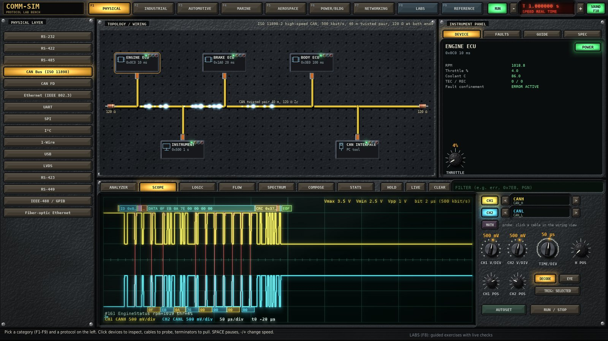
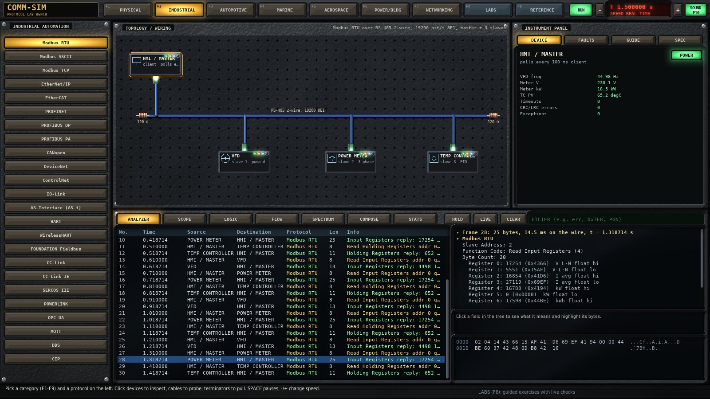
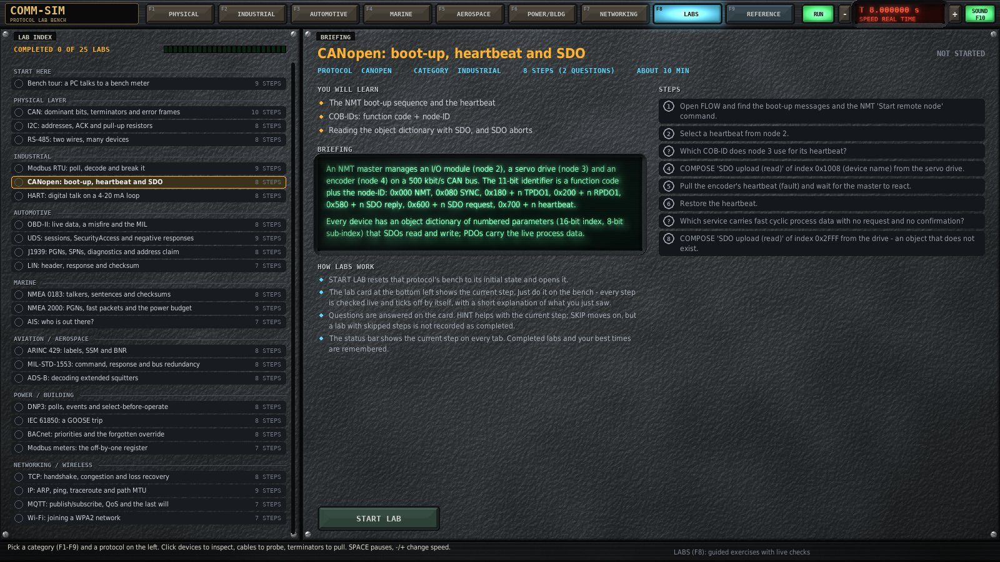
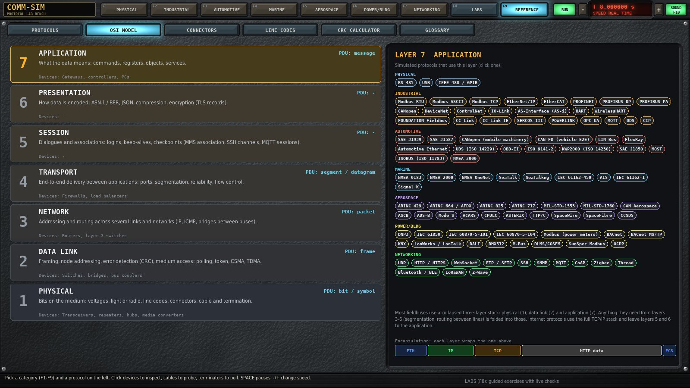

# COMM-SIM

A 2D communication-protocol lab bench written in Python (pygame + numpy).
Every protocol is a small live network - devices, cables, terminators - that
exchanges real, byte-exact frames on simulated wires. You watch them with the
instruments an engineer would use (protocol analyzer, oscilloscope, logic
analyzer, sequence diagram, spectrum analyzer), send your own messages, and
break things: pull a terminator, swap a pair, give two devices the same
address, drop a link, and see exactly how the protocol reacts.

117 protocols in 7 categories (NMEA 2000 is listed under both Automotive and
Marine), 25 guided labs that check your actions live, and a reference section
with protocol stacks, connector pin-outs, line codes, a CRC calculator and a
glossary.



## Run it

```
pip install -r requirements.txt
python run.py
```

Python 3.9+. `pygame-ce` is recommended; classic `pygame` 2.x also works.
The window is 1600x900 and scales when resized (F11 = full screen). There
are no asset files: the artwork is rendered and the sounds synthesised when
the program starts.

## Linux AppImage

A Linux x86_64 AppImage is built automatically on pushes to `main`, version
tags and pull requests, and can be started by hand from the
[Build Linux AppImage workflow](https://github.com/nrobertson152/comm-sim/actions/workflows/appimage.yml).
Open a successful run, download the **COMM-SIM-linux-x86_64** artifact,
unzip it and run:

```bash
chmod +x COMM-SIM-x86_64.AppImage
./COMM-SIM-x86_64.AppImage
```

The AppImage bundles Python and the pip dependencies. Without FUSE, start it
with `APPIMAGE_EXTRACT_AND_RUN=1 ./COMM-SIM-x86_64.AppImage`. Workflow
artifacts are kept for 30 days.

## Controls

| Key / mouse | Action |
| --- | --- |
| F1 - F7 | protocol categories |
| F8 / F9 | LABS / REFERENCE |
| F10 / F11 | mute / full screen |
| SPACE | pause / run the simulation |
| - / + | time scale: 1/10000x ... real time ... 100x |
| click a device | DEVICE panel: live state, knobs and actions |
| click a cable | clip the scope's channel 1 onto that net |
| click a terminator | pull it out / put it back |
| drag a radio node | move it on the map (link margins update) |
| mouse wheel | scroll lists, turn knobs |

Hover any control: the status bar explains it.

## The bench

Pick a category tab and a protocol on the left. The bench has three areas.

**Wiring view** - the network as it is built: devices with their activity
LEDs, the cable with frames travelling along it, terminators, couplers, power
supplies, or a map with link margins for radio protocols.

**Instrument panel** - DEVICE (state, variables, knobs and buttons of the
selected device), FAULTS (wiring, timing, configuration and protocol faults
to inject), GUIDE (what the protocol is for and experiments to try) and SPEC
(key facts and frame layout).

**Instruments**

- **ANALYZER** - every frame with time, source, destination, protocol and a
  decoded summary; a dissection tree linked to the hex dump; display filter;
  HOLD / LIVE / CLEAR.
- **SCOPE** - the real voltages, currents, light or RF envelope of the selected
  frame, with probes on each net, MATH (CH1 - CH2), serial decode overlay, eye
  diagram and AUTOSET. Ringing from missing terminators, slow I2C edges, MLT-3
  levels, the HART FSK on a 4-20 mA loop are all there.
- **LOGIC** - the same frame as logic levels with every field, stuff bit and
  sample point marked.
- **FLOW** - a sequence diagram of who talks to whom.
- **SPECTRUM** - spectrum and waterfall: channel hopping, interference, the
  energy distribution of line codes.
- **COMPOSE** - build a message field by field from templates, preview its
  bytes and transmit it; the simulated devices answer it.
- **STATS** - bus load, message rates and intervals, error counters.

## Protocols

**Physical layer** - RS-232, RS-422, RS-485, CAN, CAN FD, Ethernet, UART,
SPI, I2C, 1-Wire, USB, LVDS, RS-423, RS-449, IEEE-488 / GPIB, fiber-optic
Ethernet.

**Industrial automation** - Modbus RTU / ASCII / TCP, EtherNet/IP, EtherCAT,
PROFINET, PROFIBUS DP and PA, CANopen, DeviceNet, ControlNet, IO-Link,
AS-Interface, HART, WirelessHART, FOUNDATION Fieldbus, CC-Link, CC-Link IE,
SERCOS III, POWERLINK, OPC UA, MQTT (Sparkplug B), DDS, CIP.

**Automotive / heavy equipment** - SAE J1939, J1708, J1587, CANopen for
mobile machinery, CAN FD with AUTOSAR E2E, LIN, FlexRay, automotive Ethernet
(SOME/IP, DoIP), UDS, ISO-TP, OBD-II, ISO 9141-2, KWP2000, J1850, SENT, PSI5,
MOST, ISOBUS, NMEA 2000.

**Marine electronics** - NMEA 0183, NMEA 2000, NMEA OneNet, SeaTalk,
SeaTalkng, IEC 61162-450, AIS, IEC 61162-1, Signal K.

**Aviation / aerospace** - ARINC 429, 629, 664 (AFDX), 825, 717,
MIL-STD-1553, MIL-STD-1760, CANaerospace, ASCB, ADS-B, Mode S, ACARS, CPDLC,
ASTERIX, TTP/C, SpaceWire, SpaceFibre, CCSDS. MIL-STD-1760 is covered at
concept level only: it shows that the aircraft-store interface carries its
data on a MIL-STD-1553 bus, with ordinary 1553 traffic; no store-management
functions are modelled.

**Power / building automation** - DNP3, IEC 61850 (GOOSE, Sampled Values,
MMS), IEC 60870-5-101 and -104, Modbus power meters, BACnet/IP, BACnet MS/TP,
KNX, LonWorks, DALI, DMX512 with RDM, M-Bus, DLMS/COSEM, SunSpec, OCPP.

**Networking / wireless** - TCP, UDP (DHCP, DNS, NTP, RTP), IPv4 / IPv6,
HTTP / HTTPS, WebSocket, FTP / SFTP, SSH, SNMP, MQTT, CoAP, Zigbee, Thread,
Bluetooth Low Energy, Wi-Fi, LoRaWAN, Z-Wave, IEEE 802.15.4.



## Labs

**F8 LABS** - 25 guided exercises, about 10 minutes each. START LAB resets
that protocol's bench and opens it; a card at the bottom left shows the
current step, and every step is checked live against the simulation - select
a frame, open an instrument, inject a fault, send a message, read a device -
then explains what you just saw. Multiple-choice questions are answered on
the card. Completed labs and best times are remembered in
`~/.commsim/labs.json`.

Bench tour (RS-232); CAN terminators and error frames; I2C addressing and
pull-ups; RS-485 bias and contention; Modbus RTU; CANopen; HART; OBD-II;
UDS SecurityAccess; J1939; LIN; NMEA 0183; NMEA 2000; AIS; ARINC 429;
MIL-STD-1553; ADS-B; DNP3; IEC 61850 GOOSE; BACnet priorities; Modbus meter
registers; TCP congestion and loss; IP / traceroute / path MTU; MQTT; Wi-Fi
WPA2 join.



## Reference

**F9 REFERENCE** - a protocol matrix (physical layer, bit rate and the OSI
layers each protocol uses, with its key facts), the OSI model with the
simulated protocols on each layer, connector pin-outs (DE-9 RS-232 / CAN /
PROFIBUS, RJ45, OBD-II, J1939, M12, GPIB ...), line codes drawn from your own
bit pattern (NRZ, NRZI, Manchester, differential Manchester, biphase mark,
bipolar RZ, AMI, MLT-3, FSK), a calculator for all 23 CRCs used by the
simulator with their parameters and check values, and a glossary.



## Look and sound

The look and the sound come from the toolkit of
[RADAR-SIM](https://github.com/nrobertson152/radar-sim): panels, knobs,
buttons and displays are rendered as lit 2.5D hardware once and cached as
sprites; displays get glass, bloom and scan lines. The bench has a line
monitor, as if a small speaker were clipped onto the bus: at real time every
frame ticks, in slow motion you hear the individual bits, radio links hiss,
and HART's FSK warbles on the 4-20 mA loop. Switches, relays and fans make
their own sounds. F10 mutes.

## Tests

```
python tests/test_bits.py        # every CRC against its check value, checksums, floats
python tests/test_protocols.py   # every protocol: faults, composer templates, frame models
python tests/test_input.py       # real mouse / keyboard event paths
python tests/test_labs.py        # plays every lab to the end on the real bench
python run.py --selftest shots   # one screenshot per protocol plus LABS and REFERENCE
```

## Scope and accuracy

Frame formats, field encodings, CRCs, timings and procedures follow the public
specifications as generally documented, and the frames are byte-exact where
it matters for learning (checksums, CRCs, bit stuffing, encodings). The
networks, devices, values and vendor details are fictional, the analog models
are simplified, and some timings are shortened so that things happen while
you watch. COMM-SIM is a study aid - not a certified tool, not a conformance
test and not a substitute for the standards.

## Layout

```
commsim/
  main.py        window, tabs, time control, status bar     engine.py   discrete-event core, frames, dissection builder
  bench.py       wiring view + instrument panel + rack      topo.py     wiring view and radio map
  instruments.py analyzer, scope, logic, flow, spectrum,    phy.py      electrical / optical / RF line models
                 composer, stats                            bits.py     CRCs, checksums, line codes, stuffing
  labs.py        LABS tab and lab card                      labdata.py  the 25 labs and their checks
  reference.py   REFERENCE tab                              refdata.py  stacks, connectors, line codes, glossary
  ui.py fx.py audio.py   widgets, lit sprites, synthesised sound
  protocols/     one module group per category (phys, industrial, auto, marine, aero, power, net)
                 plus shared families (fam.py: CAN, Ethernet, serial; webfam.py: TCP/IP helpers)
```

Licensed under GPL-3.0 (see LICENSE).
